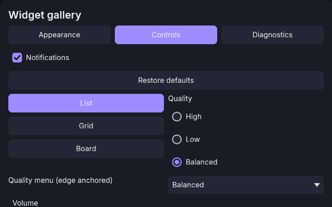
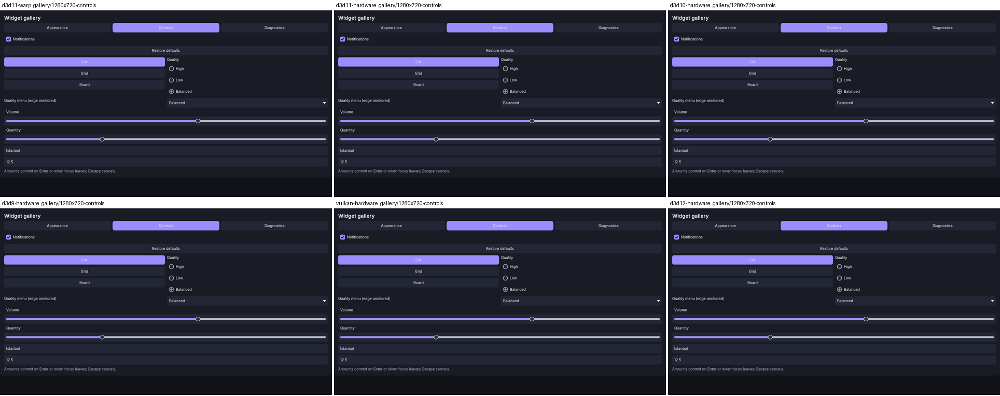
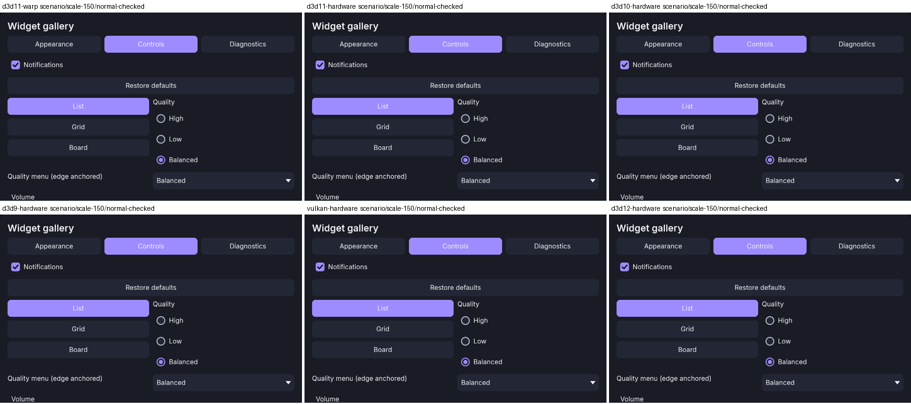

# wui

**wui** is a C++20 immediate-mode GUI library for Windows 10 x64 and later. You
describe the UI every frame with plain function calls. wui turns that into an
immutable draw packet, and a renderer backend draws it with **Direct3D 9, 10,
11, 12 or Vulkan**. A Win32 adapter feeds it mouse, keyboard, text, IME and
DPI input.

<p align="center">
  
</p>

## Why wui

- **Good-looking defaults.** One dark theme (`Theme::dark()`) with comfortable
  and compact density, accent colors, prominent/quiet button variants,
  visible focus and disabled states, and Inter as the bundled typeface. Text
  is shaped with HarfBuzz and FreeType, so Unicode text such as “İstanbul”
  renders correctly.
- **Independent modules.** Each module is a separate CMake target, and you
  link only what you use:
  - `wui::core`: portable widgets, layout and paint. It has no Windows or GPU
    dependency.
  - `wui::text`: the text service (fonts, shaping, glyph atlas).
  - `wui::win32`: the input adapter for a window that you own.
  - `wui::d3d9`, `wui::d3d10`, `wui::d3d11`, `wui::d3d12`, `wui::vulkan`:
    the renderers.

  Your application keeps ownership of the window, device, swap chain and
  message loop. wui never creates windows and never starts threads.
- **Five renderer backends, one look.** The same UI source and the same
  replayable scenarios run through all five renderers. A common suite of
  88 conformance cases compares their output against one reference (see
  [`docs/validation/d-backend-conformance.md`](docs/validation/d-backend-conformance.md)).
- **A useful widget set.** Panels, rows/columns, scroll areas with
  virtualized fixed-height rows, text, headings and descriptions, buttons,
  icon buttons, checkboxes, radio groups, tabs, dropdowns, sliders, UTF-8 text
  input with clipboard and IME, a wrapping multi-line text area, a data grid
  with sortable, resizable columns and virtualized rows, numeric input
  (`double`/`float`/`int`), start/center/end text alignment,
  tooltips, inline validation, popups and overlays, scoped styles, and custom
  painting through `Canvas`.
- **Zero allocations in the warmed gallery.** The fixed widget gallery made
  no C++ `new` calls on the UI thread between `begin_frame` and `finish` in
  all 300 warmed, measured frames of every batch (D3D11, hardware and WARP).
  This claim does not cover `malloc`, other threads or driver allocations.
  See
  [`docs/validation/c-gallery-report.md`](docs/validation/c-gallery-report.md)
  for the scope and the measurements.



## Requirements

- Windows 10 x64 or later
- Visual Studio 2022 (MSVC x64) and a Windows 10/11 SDK
- CMake 3.24 or later, and Ninja
- Python 3, Git and Meson. These are used only by
  `tools/prepare_dependencies.py`, to fetch and build the text dependencies.
- For the Vulkan backend: a Vulkan SDK with `glslangValidator`. Its tests also
  need `VK_LAYER_KHRONOS_validation`.

Run every command below from an **x64 Native Tools / Developer Command
Prompt**, so that MSVC, CMake and Ninja are on `PATH`. For Vulkan, also set
`VULKAN_SDK`. The integration docs mention `out\native-env.cmd` and
`out\vulkan-env.cmd`. Those are machine-local helper scripts that set up this
same environment. They are not part of the repository.

## Get the dependencies

The text module uses FreeType, HarfBuzz and utf8proc, and the tests use
doctest. All of them are pinned by commit in
[`third_party/lock.json`](third_party/lock.json). A normal CMake configure
**never downloads anything**. You fetch and build the dependencies once, as an
explicit step:

```bat
python tools/prepare_dependencies.py --fetch
python tools/prepare_dependencies.py --build --config Debug
python tools/prepare_dependencies.py --build --config Release
```

`--fetch` checks out the locked revisions under `third_party/` and checks the
Inter font hashes. `--build` installs the libraries to `out/deps/<Config>`.
`--verify` checks the staged revisions again without network access. The
`core-debug` and `win32-*` presets do not need these dependencies.

## Build

Each preset in [`CMakePresets.json`](CMakePresets.json) builds into
`out/<preset>`. Every configure preset has matching build and test presets.

| Preset | Builds |
| --- | --- |
| `core-debug` | Portable core only (no text, Windows or GPU) |
| `core-text-debug` | Core and text |
| `win32-debug` / `win32-release` | Core and Win32 adapter |
| `win-d3d11-debug` / `-release` | Core, text, Win32 and D3D11 |
| `win-d3d9-*`, `win-d3d10-*`, `win-d3d12-*`, `win-vulkan-*` | Core, text and that renderer |
| `win-all-debug` / `win-all-release` | Everything, plus conformance on the hardware adapter |

```bat
cmake --preset win-all-debug
cmake --build --preset win-all-debug
ctest --preset win-all-debug -E wui-win32-clipboard
```

`wui-win32-clipboard` runs in an isolated, newly created window station. It
may need administrator rights, so exclude it from ordinary runs.

### Use it from another CMake project

Install a configured build, then use `find_package`:

```bat
cmake --install out/win-all-release --prefix C:/sdk/wui
```

```cmake
find_package(wui 0.1 REQUIRED COMPONENTS core text win32 d3d11)
target_link_libraries(my_app PRIVATE wui::core wui::text wui::win32 wui::d3d11)
```

The installed package includes the headers, static libraries, the Inter fonts
(`share/wui/fonts`), `LICENSE` and `THIRD_PARTY_NOTICES.txt`.

## Minimal usage

This is taken from the installed-package consumer test
([`tests/package/consumer/main.cpp`](tests/package/consumer/main.cpp)). Every
fallible call returns `wui::Result<T>`, a `std::variant` of a value and a
`wui::Error`:

```cpp
#include <wui/wui.hpp>

// regular / semibold: the bytes of assets/fonts/Inter-Regular.ttf and Inter-SemiBold.ttf
auto textures = std::make_shared<wui::TextureStore>(64u << 20);
auto text = wui::make_text_service(regular, semibold, textures);
if (auto* error = std::get_if<wui::Error>(&text)) return fail(*error);

wui::ContextDesc desc;            // Theme::dark() by default
desc.textures = textures;
desc.text = std::get<std::shared_ptr<wui::IText>>(text);
auto context = wui::Context::create(desc);
if (auto* error = std::get_if<wui::Error>(&context)) return fail(*error);
bool notifications = true;       // application state; widgets edit it in place
auto& ui = *std::get<std::unique_ptr<wui::Context>>(context);

// Every frame. A real host gets FrameInput from wui::win32::Adapter::take_frame(dt).
wui::FrameInput input;
input.viewport = {0, 0, 640, 400};
auto begun = ui.begin_frame(input);
if (auto* error = std::get_if<wui::Error>(&begun)) return fail(*error);
auto& frame = std::get<wui::Frame>(begun);
{
    auto panel = frame.panel("settings", {.title = "Settings"});
    frame.heading("Preferences");
    if (frame.button("ok", "OK")) { /* clicked */ }
    frame.checkbox("notifications", "Notifications", notifications);
}
auto packet = frame.finish();     // Result<DrawPacket>: hand it to a renderer
```

The widget gallery
([`examples/widget_gallery/gallery.cpp`](examples/widget_gallery/gallery.cpp))
shows every widget, plus rows, scroll areas, style scopes and custom
painting. For a complete Win32 + D3D11 host loop (DPI, `WndProc`, resize,
backpressure), see [`examples/widget_gallery/native_app.cpp`](examples/widget_gallery/native_app.cpp)
and the D3D11 integration guide.

## Run the gallery

The gallery is a Win32 + D3D11 application and is opt-in:

```bat
cmake --preset win-d3d11-debug -DWUI_BUILD_EXAMPLES=ON
cmake --build --preset win-d3d11-debug
out\win-d3d11-debug\wui_widget_gallery.exe
```

The build copies the Inter fonts next to the executable, so you can start it
from any working directory. Options:

- `--driver hardware|warp` (the default is `hardware`; it never falls back to
  WARP silently)
- `--validate <dir>`: replays the ten acceptance scenarios and writes
  screenshots and `validation.txt`
- `--measure <dir> [--workload gallery|controls100|controls1000|virtual10000]`:
  records CPU/GPU timings and allocation counts
- `--help`



## Backend integration guides

Each guide covers what the host owns and what the renderer owns, the
per-frame order, resize and device loss, textures, and what the tests do not
exercise.

- [Direct3D 9](docs/integration/d3d9.md)
- [Direct3D 10](docs/integration/d3d10.md)
- [Direct3D 11](docs/integration/d3d11.md). Start here: it also covers the
  Win32 adapter, fonts, embedding in an existing window, and the gallery CLI.
- [Direct3D 12](docs/integration/d3d12.md)
- [Vulkan](docs/integration/vulkan.md)

The renderers output SDR (8-bit UNORM targets). They do not use any D3DX
helper library.

## Project layout

| Path | Contents |
| --- | --- |
| `include/wui/` | Public headers (`wui.hpp`, `frame.hpp`, `context.hpp`, `text.hpp`, …) and `backends/` |
| `src/` | Core, layout, paint, style, input, text and widget implementation |
| `backends/` | Win32 adapter and the five renderers |
| `examples/widget_gallery/` | Gallery, scenario replay, validation and measurement host |
| `tests/` | Unit, renderer, conformance, CMake and package tests |
| `assets/fonts/` | Inter Regular/SemiBold and their license |
| `docs/` | Integration guides and validation evidence |

## License

wui is released under the [MIT License](LICENSE).

A wui binary links or ships FreeType (FTL), HarfBuzz (MIT) and utf8proc (MIT),
and bundles the Inter font (SIL Open Font License 1.1). The full texts are in
[`THIRD_PARTY_NOTICES.txt`](THIRD_PARTY_NOTICES.txt), and the pinned versions
are in [`third_party/NOTICES.md`](third_party/NOTICES.md) and
[`third_party/lock.json`](third_party/lock.json). The Inter license is also in
[`assets/fonts/LICENSE.txt`](assets/fonts/LICENSE.txt).
